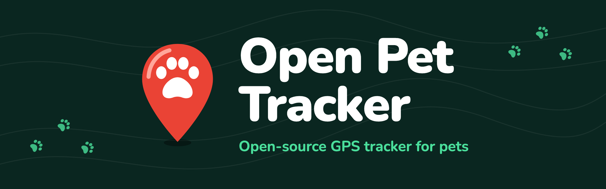

  

## Welcome

Open Pet Tracker is an open-source GPS tracker for dogs and cats. The firmware, the app and the server are all open, so you can host everything yourself or let us host it, and your data stays yours either way.

We're still building it. The code will appear here as each part is ready.

- **Website:** [openpettracker.com](https://openpettracker.com)
- **How it works:** [openpettracker.com/how-it-works](https://openpettracker.com/how-it-works/)
- **Why open source?** [openpettracker.com/why-open-source](https://openpettracker.com/why-open-source/)
- **Get an email when it's ready:** [sign up for updates](https://openpettracker.com/#updates)
